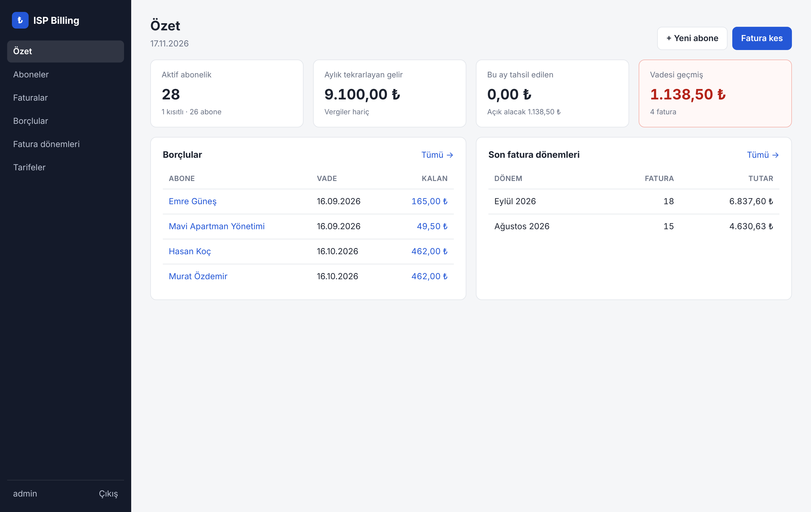
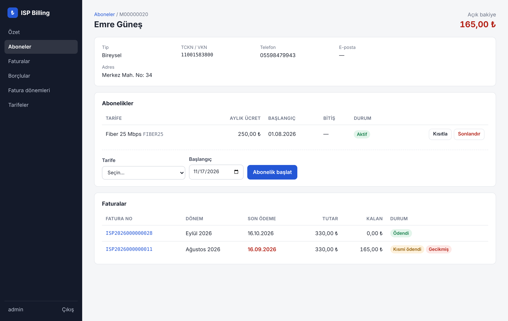
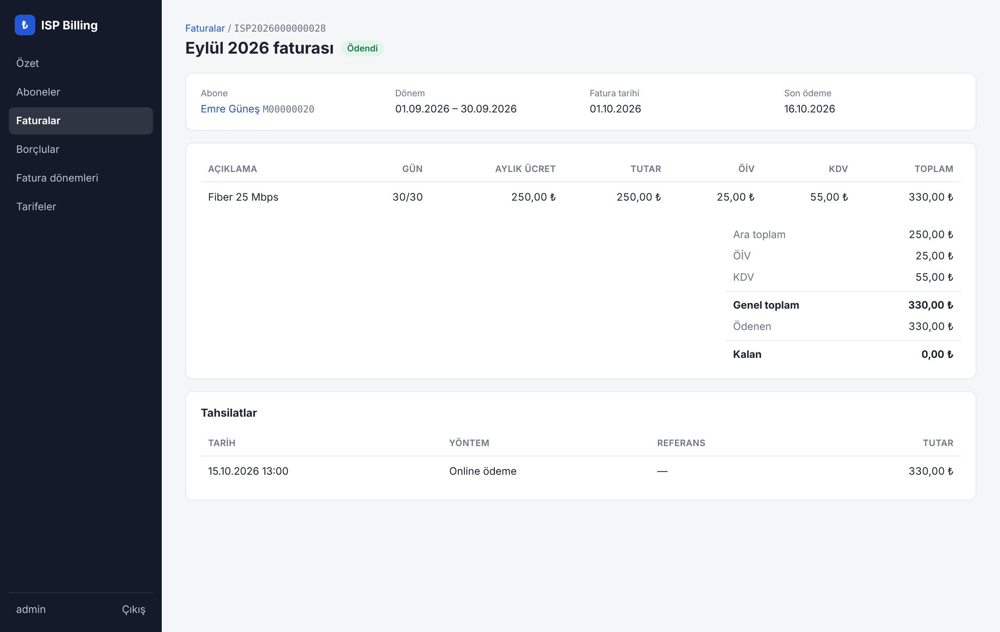

# ISP360

Küçük internet servis sağlayıcıları (fiber, kablosuz/WISP, site interneti) için abone faturalandırma sistemi.
İSS'nin kendi sunucusuna kurulur; kurulum, destek ve fatura başına ücretle lisanslanır.

📐 **Mimari ve yol haritası:** [docs/TEKNIK_MIMARI.md](docs/TEKNIK_MIMARI.md)\
🔌 **Entegrasyon rehberi (API + giriş tabloları):** [docs/ENTEGRASYON.md](docs/ENTEGRASYON.md)

**Durum:** MVP. Abone → tarife → abonelik → aylık fatura dönemi (bill run) → fatura → tahsilat akışı
REST API'den, giriş tablolarından (import batch) ve hazır yönetim panelinden çalışıyor.



## Teknoloji
- Java 21, Spring Boot 3.5, Spring Security
- Panel: Thymeleaf (sunucu tarafında üretilen sayfalar, ayrı bir frontend projesi yok)
- PostgreSQL 16, Flyway (şema: `src/main/resources/db/migration`)

## Çalıştırma

```bash
docker compose up -d          # PostgreSQL (billing + billing_test veritabanları)
mvn spring-boot:run           # http://localhost:8080
mvn test                      # birim + uçtan uca testler (billing_test veritabanını kullanır)
```

### Panel girişi
İlk açılışta hiç kullanıcı yoksa `admin` kullanıcısı oluşturulur. Şifreyi `BILLING_ADMIN_PASSWORD` ile verin;
vermezseniz rastgele bir şifre üretilip uygulama loguna yazılır.

```bash
BILLING_ADMIN_PASSWORD=gizli123 mvn spring-boot:run
```

### Demo modu (satış görüşmeleri için)
Boş bir veritabanına 26 örnek abone, 5 tarife, geçmiş iki aylık fatura, tahsilatlar ve borçlular yükler.
Geçen ay faturalanmadan bırakılır, böylece demoda "Faturaları kes" canlı gösterilebilir.

```bash
BILLING_ADMIN_PASSWORD=demo1234 mvn spring-boot:run -Dspring-boot.run.profiles=demo
```

Veritabanı bağlantısı ortam değişkenleriyle değiştirilebilir: `DB_URL`, `DB_USER`, `DB_PASSWORD`, `TEST_DB_URL`.

## Faturalandırma kuralları

| Kural | Açıklama |
|---|---|
| Dönem | Takvim ayı (1'i – ay sonu) |
| Kıst (prorate) | `aylık ücret × aktif gün / dönemdeki gün`. Başlangıç ve bitiş günleri dahil |
| ÖİV | Net tutar üzerinden |
| KDV | `(net + ÖİV) × KDV oranı`: ÖİV, KDV matrahına dahil |
| Yuvarlama | Her adımda 2 hane, HALF_UP |
| Fatura | Abone başına dönemde tek fatura, her abonelik bir satır |
| Tekrar koruması | Aynı dönem iki kez çalıştırılamaz (`bill_run.period_start` UNIQUE), bir abonelik aynı dönemde iki kez faturalanamaz (`invoice_line` UNIQUE) |
| Askıya alınmış abonelik | Faturalanmaya devam eder (borçtan kısıtlama hizmeti durdurur, sözleşmeyi değil) |
| Sonlandırılmış abonelik | `end_date`'e kadar kıst olarak faturalanır |
| Fatura no | e-Arşiv biçimi: `ÖNEK(3) + YIL(4) + SIRA(9)` → `ISP2026000000001` |

> ⚠️ ÖİV/KDV oranları tarifede tutulur ve kurallar canlıya çıkmadan önce bir mali müşavirle doğrulanmalıdır.

## Panel

| Sayfa | Ne yapılır |
|---|---|
| Özet | Aktif abonelik, aylık tekrarlayan gelir, bu ay tahsilat, vadesi geçmiş alacak; borçlular ve son dönemler |
| Aboneler | Arama (ad / abone no / TCKN-VKN), yeni abone, abone detayı: abonelik başlat, kısıtla, aç, sonlandır; açık bakiye ve faturalar |
| Faturalar | Ödenmemiş / ödenmiş / tümü; fatura detayında satırlar, vergi dökümü ve tahsilat kaydı |
| Borçlular | Vadesi geçmiş faturalar, gecikme günü ve toplam gecikmiş alacak |
| Fatura dönemleri | Bir ayı tek tıkla faturala, geçmiş çalıştırmalar |
| Tarifeler | Tarife ekle (vergiler dahil tutar otomatik gösterilir), satışa aç/kapat |
| Veri aktarımı | Giriş tablolarının durumu, hatalı kayıtlar ve nedenleri, elle çalıştırma, yeniden deneme |

Tutarlar Türkçe biçimde girilebilir: `1.234,56`, `396,00` veya `396.00`.

| Abone detayı | Fatura |
|---|---|
|  |  |

## API

Canlı doküman: `/swagger-ui.html` (panel girişi gerekir). Ayrıntılı rehber: [docs/ENTEGRASYON.md](docs/ENTEGRASYON.md).

Tüm `/api/v1/**` uçları HTTP Basic kimlik doğrulaması ister (panel kullanıcısıyla aynı): `curl -u admin:şifre ...`

| Metot | Yol | Açıklama |
|---|---|---|
| POST | `/api/v1/customers` | Abone oluştur |
| GET | `/api/v1/customers`, `/api/v1/customers/{id}` | Abone listesi / detayı |
| POST | `/api/v1/plans` | Tarife oluştur |
| GET | `/api/v1/plans`, `/api/v1/plans/{id}` | Tarife listesi / detayı |
| POST | `/api/v1/subscriptions` | Abonelik başlat |
| GET | `/api/v1/subscriptions?customerId=` | Abonenin abonelikleri |
| POST | `/api/v1/subscriptions/{id}/suspend` · `/resume` · `/terminate` | Kısıtla / aç / sonlandır |
| POST | `/api/v1/bill-runs` | Dönemi faturala: `{"period":"2026-11"}` |
| GET | `/api/v1/bill-runs` | Çalıştırma geçmişi |
| GET | `/api/v1/invoices?customerId=`, `/api/v1/invoices/{id}` | Faturalar / fatura detayı (satırlarla) |
| GET | `/api/v1/invoices/overdue` | Borçlu listesi (vadesi geçmiş, ödenmemiş) |
| POST | `/api/v1/payments` | Tahsilat: `{"invoiceId":1,"amount":100.00,"method":"ONLINE"}` |

### Örnek akış

```bash
H='Content-Type: application/json'
alias curl='curl -u admin:gizli123'
curl -XPOST localhost:8080/api/v1/customers -H "$H" -d '{"type":"INDIVIDUAL","name":"Ayşe Yılmaz","taxId":"12345678901"}'
curl -XPOST localhost:8080/api/v1/plans -H "$H" -d '{"code":"FIBER100","name":"Fiber 100 Mbps","monthlyFee":300,"oivRate":10,"vatRate":20}'
curl -XPOST localhost:8080/api/v1/subscriptions -H "$H" -d '{"customerId":1,"planId":1,"startDate":"2026-11-10"}'
curl -XPOST localhost:8080/api/v1/bill-runs -H "$H" -d '{"period":"2026-11"}'
curl "localhost:8080/api/v1/invoices?customerId=1"
```

## Yol haritası

Güncel yol haritası ve durum: [docs/TEKNIK_MIMARI.md §15](docs/TEKNIK_MIMARI.md#15-geliştirme-yol-haritası)
