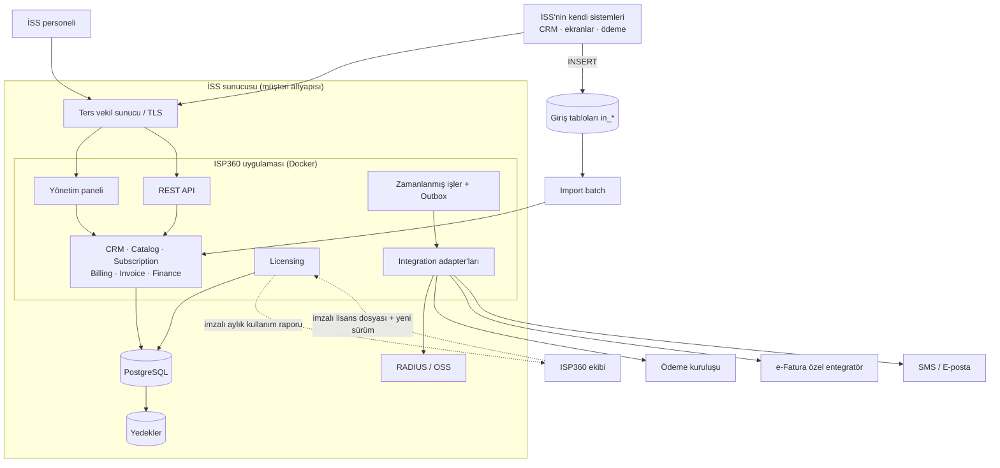
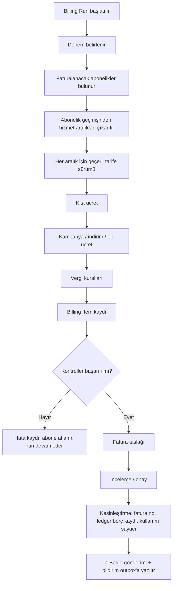
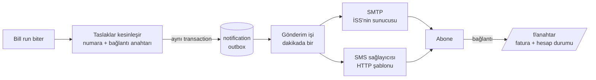

# ISP360 — Teknik Mimari ve Geliştirme Planı

**Doküman sürümü:** 2.1 (entegrasyon modeli: API + giriş tabloları + isteğe bağlı panel)\
**Ürün:** ISP360\
**Ürün modeli:** Müşteri sunucusuna kurulan (on-premise), tek firmalı (single-tenant) yazılım\
**Hedef müşteri:** Türkiye'deki küçük ve orta ölçekli internet servis sağlayıcıları (İSS)\
**Gelir modeli:** Kurulum + yıllık destek/bakım + kesilen fatura başına ücret\
**Geliştirme modeli:** Tek geliştirici (+ Claude Code ile ortak geliştirme)\
**Mimari yaklaşım:** API-first faturalandırma çekirdeği, modüler monolit, tek kurulum = tek İSS\
**Entegrasyon:** REST API + giriş (staging) tabloları + batch; hazır yönetim paneli isteğe bağlı

> Bu doküman projenin ortak çalışma belgesidir. Mimari bir karar değiştiğinde önce bu belge
> güncellenir, sonra kod. Bir maddenin durumu değiştiğinde §15'teki yol haritası işaretlenir.

------------------------------------------------------------------------

## 1. Ürün vizyonu

ISP360, internet servis sağlayıcılarının müşteri, abonelik, tarife, ücretlendirme, fatura, tahsilat
ve operasyon süreçlerini tek platformda yönetmesini sağlayan bir BSS çözümüdür. Ürün İSS'nin kendi
sunucusuna kurulur; ISP360 ekibi kurulum, güncelleme ve destek hizmeti verir.

### Temel hedefler

- İSS'nin kendi abonelerini ve kurumsal müşterilerini yönetebilmesi
- Paket, tarife, kampanya ve indirim tanımlayabilmesi
- Abonelik başlangıç, değişiklik, askıya alma ve iptal süreçlerini yönetebilmesi
- Dönemsel ve kıst ücret hesaplaması yapabilmesi
- Fatura ve tahsilat süreçlerini yönetebilmesi
- Mevcut OSS, CRM, RADIUS, ödeme ve e-belge sistemleriyle entegre olabilmesi
- **Tek komutla kurulabilmesi ve güncellenebilmesi**
- **Kesilen fatura sayısının güvenilir biçimde ölçülebilmesi (gelir modelimizin temeli)**

### Ürün kapsamı

| Modül | Sorumluluk |
|---|---|
| Identity & Access | Kullanıcı, rol ve yetki yönetimi |
| CRM | Müşteri, adres, iletişim |
| Catalog | Tarife, tarife sürümleri, kampanya ve indirim |
| Subscription | Abonelik yaşam döngüsü ve geçmişi |
| Billing Engine | Dönemsel ücret, kıst ücret, ek ücret, indirim, vergi |
| Invoice | Fatura taslağı, kesinleştirme, iptal/iade faturası |
| Finance | Tahsilat, ödeme dağıtımı, iade, mahsup, cari hesap (ledger) |
| Integration | RADIUS, OSS, ödeme kuruluşu, e-belge (özel entegratör) adapter'ları |
| Notification | SMS ve e-posta bildirimleri |
| Reporting | Gelir, tahsilat, borç ve abone raporları |
| **Licensing** | Lisans doğrulama, kullanım (fatura) sayacı, kullanım raporu |
| **Operations** | Sürüm bilgisi, sağlık kontrolü, destek paketi (log + teşhis) |
| Customer Portal | Abone self-servis ekranları (sonraki sürüm) |

İlk sürümde ağ altyapısı ISP360 tarafından yönetilmez; İSS'nin mevcut sistemlerine adapter ile
bağlanılır.

------------------------------------------------------------------------

## 2. Dağıtım ve iş modeli

### 2.1 Neden kurulum tabanlı model?

| Konu | Kurulum tabanlı (seçilen) | SaaS (v1.0 planı) |
|---|---|---|
| Sunucu ve barındırma maliyeti | Müşteride | Bizde |
| Altyapı güvenliği (sunucu, ağ, yedek, işletim sistemi) | Müşteride | Bizde |
| Abone verisi | İSS'de kalır | Bizde durur, KVKK yükümlülüğü artar |
| Çoklu firma (tenant) izolasyonu | **Gerekmez:** her kurulum tek İSS | tenant_id + RLS zorunlu |
| Güncelleme dağıtımı | Her kurulum ayrı ayrı (zorluk) | Tek noktadan |
| Kullanım ölçümü | Lisans + kullanım raporu gerekir (zorluk) | Doğrudan veritabanından |
| Destek | Her ortam farklı (zorluk) | Tek ortam |

Kararın yan etkisi: v1.0 belgesindeki `tenant_id`, RLS ve tenant context gereksinimleri **kapsam
dışıdır**. Uygulama tek firmalı tasarlanır.

### 2.2 Barındırma seçeneği

Sunucusu veya bilgi işlem personeli olmayan küçük İSS'ler için aynı kurulum paketi ISP360 ekibinin
kiraladığı ayrı bir sunucuya da kurulabilir (yönetilen kurulum). Kod aynı kalır; yalnızca sorumluluk
matrisi ve fiyat değişir. Bu seçenek ilk sürümde zorunlu değildir, ancak mimari bunu engellememelidir.

### 2.3 Gelir kalemleri

| Kalem | Açıklama |
|---|---|
| Kurulum ücreti | Tek seferlik: kurulum, ilk yapılandırma, eğitim |
| Veri aktarımı | Tek seferlik: mevcut sistem / Excel'den abone, tarife ve bakiye aktarımı |
| Yıllık destek ve bakım | Güncellemeler, uzaktan destek, mevzuat değişikliği uyarlamaları |
| **Fatura başına ücret** | Kesinleşmiş her fatura için aylık faturalanan kullanım ücreti |
| Özel entegrasyon | İSS'ye özgü OSS/RADIUS/muhasebe entegrasyonları için proje ücreti |
| Yönetilen kurulum (opsiyonel) | Sunucuyu bizim işlettiğimiz müşteriler için aylık barındırma ücreti |

> Fiyatlar pazar görüşmeleriyle belirlenecek. Bu belgede rakam verilmemesi bilinçli bir karardır;
> İSS görüşmelerinde "şu an faturalandırmaya ne ödüyorsunuz?" sorusunun cevabı toplanmalıdır.

### 2.4 Sorumluluk matrisi

Bu tablo müşteri sözleşmesine ek olarak konulmalıdır. "Güvenlik müşteride" ifadesi yalnızca altyapı
için geçerlidir; **yazılımın kendi güvenliği her zaman ISP360'ın sorumluluğundadır.**

| Konu | Müşteri (İSS) | ISP360 |
|---|---|---|
| Sunucu donanımı / sanal makine | ✔ | |
| İşletim sistemi kurulumu ve güvenlik yamaları | ✔ | Desteklenen sürümü belirtir |
| Ağ güvenliği, güvenlik duvarı, VPN | ✔ | Gereken portları belirtir |
| TLS sertifikası | ✔ | Kurulum betiğinde destek |
| Veritabanı yedeği alınması ve saklanması | ✔ | Yedek ve geri yükleme betiğini sağlar |
| Geri yükleme testinin yapılması | ✔ | Yılda bir kez birlikte test önerilir |
| Kullanıcı hesapları ve şifreleri | ✔ | Şifre politikası ve kilitleme uygulamada |
| Uygulama kodundaki güvenlik açıkları | | ✔ |
| Uygulama güncellemelerinin hazırlanması | | ✔ |
| Güncellemelerin uygulanması | ✔ (onay) | ✔ (uygulama, bakım sözleşmesi varsa) |
| Hesaplama doğruluğu (kıst, vergi, toplamlar) | | ✔ |
| Vergi oranlarının ve tarife fiyatlarının girilmesi | ✔ | Varsayılanları sağlar |
| Mevzuata uygunluğun son kontrolü | ✔ (mali müşavir) | Değişiklikleri takip eder, uyarlar |
| KVKK: veri sorumlusu | ✔ | |
| KVKK: uzaktan destekte veri işleyen | | ✔ (veri işleme sözleşmesi imzalanır) |

### 2.5 Entegrasyon modeli

ISP360 bir **faturalandırma çekirdeğidir**. İSS'nin kendi sistemleri (CRM, abone yönetimi, kendi ekranları,
ödeme altyapısı) çekirdeği besler; fatura günlerinde faturalandırma batch'i çalışır ve faturalar
aboneye gider. Bu, büyük operatörlerdeki BSCS benzeri modelin küçük ölçekli karşılığıdır.

| Kanal | Kim kullanır | Ne için |
|---|---|---|
| **REST API (`/api/v1`)** | Kendi ekranı/yazılım ekibi olan İSS | Anlık işlemler, sonucun hemen dönmesi |
| **Giriş tabloları (`in_*`) + import batch** | Mevcut sistemi olan İSS, ilk veri yükleme | Toplu ve düzenli besleme |
| **Hazır yönetim paneli** | Yazılım ekibi olmayan küçük İSS | Tüm işlemler ekrandan |

Üç kanal da **aynı servis katmanından** geçer; iş kuralları tek yerdedir.

**Temel kural: müşteri sistemleri core tablolara doğrudan yazmaz ve okumaz.**

- Core tablo yapısı ürün geliştikçe değişebilir. Müşteriye karşı sabit tutulan sözleşme yalnızca
  `/api/v1` ve `in_*` tablolarıdır. Sözleşme kuralları: [ENTEGRASYON.md §6](ENTEGRASYON.md#7-sözleşme-ve-sürüm-kuralları).
- Giriş tablosu satırları import batch'inde doğrulanır. Hatalı veri core'a ve faturaya girmez;
  hata kodu ve açıklaması aynı satıra geri yazılır.
- Faturada sorun çıktığında hatanın beslenen veriden mi motordan mı kaynaklandığı satır kayıtlarından
  izlenebilir. Bu, müşteriyle anlaşmazlıklarda ISP360'ı korur.
- Müşterinin entegrasyon veritabanı kullanıcısı yalnızca `in_*` tablolarına `SELECT, INSERT` yetkisine sahiptir.
- Her kayıt müşterinin kendi kimliği (`external_ref`) ile gelir. Ödemelerde aynı kimlik ikinci kez
  işlenmez (`DUPLICATE`), böylece ödeme bildirimleri güvenle tekrar gönderilebilir.

Müşteriye verilecek ayrıntılı rehber: **[ENTEGRASYON.md](ENTEGRASYON.md)**.

------------------------------------------------------------------------

## 3. Mimari kararlar

| Alan | Karar | Durum |
|---|---|---|
| Mimari | Tek firmalı modüler monolit | ✔ Uygulandı |
| Backend | Java 21 + Spring Boot 3.5 | ✔ Uygulandı |
| Yönetim paneli | Thymeleaf (sunucu tarafında üretilen sayfalar) | ✔ Uygulandı |
| Veritabanı | PostgreSQL 16 | ✔ Uygulandı |
| Veri erişimi | Spring Data JPA; rapor ve toplu işlerde JdbcClient (düz SQL) | ✔ Uygulandı |
| Migration | Flyway, yalnızca ileriye dönük ve geriye uyumlu | ✔ Uygulandı |
| Güvenlik | Spring Security: panel form girişi, API HTTP Basic | ✔ Uygulandı |
| API | REST, `/api/v1` sürümlü, OpenAPI (springdoc, `/swagger-ui.html`) | ✔ Uygulandı |
| Toplu entegrasyon | Giriş tabloları (`in_*`) + import batch (her dakika, satır başına transaction) | ✔ Uygulandı |
| Yönetim paneli rolü | İsteğe bağlı hazır ekran; API ile aynı servisleri kullanır | ✔ Uygulandı |
| Arka plan işleri | Spring Scheduler (✔ import batch) + `JOB_EXECUTION` tablosu (◻) | Kısmen |
| Güvenilir olay iletimi | PostgreSQL Outbox (ayrı mesaj kuyruğu yok) | ◻ |
| Paketleme | Docker imajı + Docker Compose | ◻ |
| Lisans | Ed25519 imzalı lisans dosyası, çevrimdışı doğrulanır | ◻ |
| Loglama | Yapılandırılmış JSON log, dosyaya döner (rotating) | ◻ |
| İzleme | `/actuator/health` + sürüm bilgisi | ◻ |

### Bilinçli olarak kapsam dışı bırakılanlar

| v1.0 önerisi | Karar | Gerekçe |
|---|---|---|
| tenant_id + PostgreSQL RLS | Çıkarıldı | Her kurulum tek İSS |
| React + TypeScript + Ant Design | Ertelendi | Thymeleaf paneli çalışıyor; tek geliştirici için ikinci kod tabanı. Abone portalında yeniden değerlendirilir. |
| Redis | Ertelendi | Tek sunuculu kurulumda gerek yok; her kurulumda ayrı bir bileşen = ayrı destek yükü |
| RabbitMQ | Ertelendi | Outbox tablosu yeterli |
| Prometheus + Grafana | Ertelendi | Müşteri sunucusunda ek bileşen; health endpoint + loglar yeterli |
| Her modülde api/application/domain/infrastructure katmanları | Uyarlandı | Modül bazlı paketler korunur, katmanlar yalnızca karmaşık modüllerde (billing) ayrılır |
| UUID birincil anahtarlar | Uyarlandı | Tek firmalı kurulumda sayısal anahtar yeterli; dışarıya açılan kimlikler için ileride UUID eklenebilir |

### Kurulum tabanlı modelin getirdiği ek kurallar

- **Kurulum bileşenleri en az sayıda olmalı:** uygulama + PostgreSQL + (isteğe bağlı) ters vekil sunucu.
- **Her sürüm her kurulumda aynı şekilde çalışmalı:** müşteriye özel kod dalı açılmaz. Müşteriye özgü
  davranış yapılandırma ve adapter ile sağlanır.
- **Migration'lar her zaman ileriye dönüktür** ve bir önceki sürümle uyumludur. Geri dönüş yedekten yapılır.
- **Uygulama internet olmadan çalışabilmelidir.** Lisans doğrulama ve kullanım raporu çevrimdışı
  çalışır; dış servisler (ödeme, SMS, e-belge) yalnızca kendi adapter'larında internete çıkar.
- **Kaynak kod müşteriye verilmez;** yalnızca Docker imajı teslim edilir.

------------------------------------------------------------------------

## 4. Sistem mimarisi



### İşlem akışı

1. Abone ve abonelik İSS'nin kendi sisteminden API veya giriş tablolarıyla gelir
   (ya da İSS personeli hazır panelden girer).
2. Giriş tablosu satırları import batch'inde doğrulanır ve core'a işlenir; sonuç satıra yazılır.
3. Integration modülü RADIUS/OSS'a aktivasyon komutunu outbox üzerinden gönderir.
4. Dönem sonunda Billing Run çalışır, ücret kalemleri hesaplanır.
5. Fatura taslakları oluşur, kontrol edilip kesinleştirilir; cari hesaba borç kaydı düşer.
6. Kesinleşen her fatura lisans kullanım sayacını artırır.
7. Fatura e-belge entegratörüne gönderilir, aboneye bildirim gider.
8. Tahsilat geldiğinde cari hesaba alacak kaydı düşer ve açık faturalara dağıtılır.

Modüller arası işlemlerde dış sistemlerle tek bir dağıtık transaction varsayılmaz; hata ve yeniden
deneme süreçleri açıkça tasarlanır.

------------------------------------------------------------------------

## 5. Lisans ve kullanım ölçümü

Gelir modelimiz kesilen fatura sayısına dayandığı ve sunucu müşteride olduğu için bu modül ürünün
ticari çekirdeğidir.

### 5.1 Lisans dosyası

- ISP360 ekibi, gizli anahtarıyla (Ed25519) imzalanmış bir lisans dosyası üretir.
- Uygulamada yalnızca açık anahtar bulunur; lisans çevrimdışı doğrulanır.
- Lisans içeriği:

```json
{
  "licenseId": "LIC-2026-0001",
  "customer": "Örnek İnternet Ltd. Şti.",
  "taxId": "1234567890",
  "validFrom": "2026-12-01",
  "validUntil": "2027-11-30",
  "maxActiveSubscriptions": 2500,
  "features": ["billing", "payments", "radius"],
  "invoicePrefix": "ORN"
}
```

- Lisans, İSS'nin VKN'sine ve e-Arşiv fatura önekine bağlanır. Aynı lisans başka bir İSS'de
  kullanılırsa fatura numaraları bunu ortaya çıkarır.

### 5.2 Kullanım sayacı

- `LICENSE_USAGE` tablosu: dönem (ay), kesinleşen fatura sayısı, ilk ve son fatura numarası.
- Sayaç, fatura kesinleştirme transaction'ı içinde artırılır.
- Kesinleşen faturalar bir **hash zinciri** ile birbirine bağlanır (her fatura bir öncekinin özetini
  taşır). Veritabanından fatura silinmesi veya değiştirilmesi zinciri bozar ve tespit edilebilir.

### 5.3 Aylık kullanım raporu

- Panelde "Kullanım raporu" ekranı: geçen ayın fatura sayısı ve numara aralığı.
- Rapor, kuruluma özgü anahtarla imzalanmış bir dosya olarak indirilir ve ISP360'a gönderilir
  (e-posta veya isteğe bağlı otomatik gönderim).
- **Bağımsız doğrulama:** e-Arşiv/e-Fatura numaraları yıl içinde sıralıdır ve özel entegratöre
  iletilir. Rapordaki numara aralığı, entegratör tarafındaki kayıtlarla karşılaştırılabilir.
  ISP360 entegratörün bayi/iş ortağı olursa bu kontrol doğrudan yapılabilir.

### 5.4 Kullanım sayacının bağlanacağı nokta

Fatura kesinleştirme tek bir yerde (`BillRunService.finalizeDrafts`) ve tek transaction'da yapılır. Lisans
kullanım sayacı ve hash zinciri (Faz 3) buraya eklenecektir.

### 5.5 Lisans süresi dolduğunda

İSS'nin faturalandırmasını aniden durdurmak, son kullanıcılara (abonelere) zarar verir ve ticari
ilişkiyi bozar. Bu nedenle yaptırım kademelidir:

| Durum | Davranış |
|---|---|
| Bitişe 30 gün kala | Panelde uyarı |
| Süre doldu, 0–30 gün | Uyarı + kullanım raporu zorunlu; tüm işlemler çalışır |
| 30 günden sonra | Yeni Billing Run başlatılamaz; görüntüleme, tahsilat ve raporlar çalışmaya devam eder |
| Abone sınırı aşıldı | Yeni abonelik açılamaz, mevcutlar faturalanmaya devam eder |

Teknik koruma tek başına yeterli değildir; asıl güvence sözleşmedir (kullanım raporu yükümlülüğü,
denetim hakkı, cezai şart).

------------------------------------------------------------------------

## 6. Veritabanı ve veri modeli

### 6.1 Mevcut tablolar (uygulandı)

| Tablo | Açıklama |
|---|---|
| `customer` | Bireysel ve kurumsal aboneler |
| `plan` | Tarifeler (aylık ücret, ÖİV, KDV) |
| `subscription` | Abonelikler (başlangıç/bitiş, durum) |
| `bill_cycle` | Fatura dönemleri (gün 1–28, varsayılan, otomatik çalışma) |
| `bill_run` | Toplu faturalandırma çalıştırmaları (cycle + dönem başına tekil) |
| `bill_run_error` | Çalıştırmada faturalanamayan aboneler ve nedenleri |
| `invoice` / `invoice_line` | Faturalar (DRAFT → ISSUED, numara ve bağlantı anahtarı kesinleşmede) ve kalemleri |
| `invoice_number_series` | Yıl bazında boşluksuz fatura numarası sayacı |
| `notification` | E-posta/SMS gönderim kuyruğu (outbox), deneme sayısı ve son hata |
| `payment` | Tahsilatlar (şu an tek faturaya bağlı) |
| `app_user` | Panel kullanıcıları |
| `in_customer` | Giriş tablosu: abone ekleme/güncelleme |
| `in_subscription_event` | Giriş tablosu: abonelik ACTIVATE / SUSPEND / RESUME / TERMINATE |
| `in_payment` | Giriş tablosu: tahsilat (işlem kimliğiyle tekilleştirilir) |

`customer`, `subscription` ve `payment` tablolarında müşteri sistemindeki kimlik `external_ref`
(UNIQUE) kolonunda tutulur.

### 6.2 Eklenecek tablolar

| Tablo | Açıklama | Faz |
|---|---|---|
| `customer_address` | Kurulum ve fatura adresleri | 2 |
| `tariff_version` | Tarife fiyat sürümleri ve geçerlilik tarihleri | 2 |
| `subscription_history` | Abonelik durum ve tarife değişiklik geçmişi | 2 |
| `tax_rule` | Vergi oranları ve geçerlilik tarihleri | 3 |
| `campaign` / `discount` | Kampanya ve indirim kuralları | 3 |
| `billing_item` | Hesaplanan ücret kalemleri (faturadan önce) | 3 |
| `billing_adjustment` | Düzeltme ve fark ücretleri | 3 |
| `ledger_entry` | Cari hesap borç/alacak hareketleri (değiştirilemez) | 4 |
| `payment_allocation` | Ödemenin faturalara dağıtımı | 4 |
| `payment_transaction` | Ödeme kuruluşu işlem detayları | 5 |
| `refund` | İade kayıtları | 4 |
| `integration_config` / `integration_log` | Entegrasyon ayarları ve işlem kayıtları | 5 |
| `outbox_event` | Güvenilir olay iletimi | 5 |
| `idempotency_key` | Tekrarlı istek koruması | 4 |
| `audit_log` | Kullanıcı ve sistem işlem geçmişi | 1 |
| `job_execution` | Arka plan iş takibi | 3 |
| `notification` | Bildirim kayıtları | 5 |
| `license_usage` | Aylık kesinleşmiş fatura sayacı | 1 |
| `role` / `user_role` | Rol yönetimi | 1 |

### 6.3 Veritabanı kuralları

- Para alanlarında `NUMERIC(14,2)`; FLOAT/DOUBLE kullanılmaz.
- Zaman damgaları `TIMESTAMPTZ`; fatura dönemleri kurulumun saat dilimiyle (varsayılan
  Europe/Istanbul) hesaplanır.
- Değiştirilebilir tablolarda `created_at`, `created_by`, `updated_at`, `updated_by`, `version`
  (iyimser kilitleme) alanları bulunur.
- Finansal kayıtlar (`ledger_entry`, kesinleşmiş `invoice`, `payment`) fiziksel olarak silinmez ve
  güncellenmez; düzeltmeler ters kayıtla yapılır.
- Tarife, kampanya ve abonelik geçmişi korunur.
- Mükerrer kayıt korumaları veritabanı kısıtlarıyla da güvenceye alınır (UNIQUE), yalnızca uygulama
  koduna güvenilmez.
- Uygulamanın veritabanı kullanıcısı tablo sahibi değildir; migration'lar ayrı bir kullanıcıyla
  çalışır (kurulum paketi bunu otomatik ayarlar).

------------------------------------------------------------------------

## 7. Billing Engine tasarımı

Billing Engine ürünün en kritik modülüdür. Hesaplama mantığı küçük, veritabanından bağımsız ve test
edilebilir bileşenlere ayrılır.

### 7.1 Mevcut durum

- `ChargeCalculator`: kıst ücret + ÖİV + KDV (ÖİV KDV matrahına dahil), her adımda 2 hane HALF_UP.
- `BillCycle`: cycle gününe göre dönem başlangıcı/bitişi, fatura günü, son biten dönem.
- `BillRunService`: cycle'daki faturalanacak aboneleri bulur, her aboneyi kendi transaction'ında
  faturalar; hatalı abone `bill_run_error`'a yazılır ve run devam eder; aynı dönem tekrar çalıştırılınca
  yalnızca kalan aboneler işlenir. Aboneliğin `billed_through` tarihi kesilen faturayla ilerler.

### 7.2 Hedef hesaplama akışı



### 7.3 Hesaplama bileşenleri

```java
public interface ChargeStep {
    ChargeContext apply(ChargeContext context);
}
```

| Bileşen | Sorumluluk |
|---|---|
| `ServicePeriodResolver` | Abonelik geçmişinden dönem içindeki hizmet aralıklarını çıkarır |
| `ProrationCalculator` | Kıst ücret (yöntem yapılandırılabilir) |
| `DiscountCalculator` | Kampanya ve indirimler |
| `TaxCalculator` | Tarihe göre geçerli ÖİV/KDV kuralları |
| `PenaltyCalculator` | Gecikme bedeli (mevzuat izin verdiği ölçüde) |
| `BillingOrchestrator` | Sıra, birleştirme, hata yönetimi |

Mevcut `ChargeCalculator` bu bileşenlere bölünür; tüm mevcut testler korunur.

### 7.4 Kıst ücret yöntemleri

| Yöntem | Hesap | Örnek: 600 TL, 15–30 Kasım (16 gün) |
|---|---|---|
| `ACTUAL_DAYS` (mevcut) | ücret × gün / ayın gün sayısı | 600 × 16 / 30 = 320,00 TL |
| `FIXED_30` | ücret × gün / 30 | 600 × 16 / 30 = 320,00 TL (Şubat'ta fark eder) |

Başlangıç ve bitiş günleri dahildir. Yöntem, yuvarlama ölçeği ve modu kurulum ayarıdır.

### 7.5 Tarife değişikliği

Abone 15 Kasım'da 600 TL tarifeden 900 TL tarifeye geçerse dönem iki hizmet aralığına bölünür
(1–14 Kasım eski tarife, 15–30 Kasım yeni tarife), her aralık kendi tarife sürümüyle hesaplanır ve
faturada ayrı kalem olarak görünür.

### 7.6 Finansal doğruluk kuralları

- Aynı abonelik ve dönem için mükerrer ücret oluşmaz (✔ uygulandı: UNIQUE kısıtı).
- Billing Run kaldığı yerden devam edebilir; hatalı abone tüm çalıştırmayı durdurmaz.
- Kesinleşmiş fatura güncellenmez; iptal ve düzeltme iade faturası / ters kayıtla yapılır.
- Hesaplamada kullanılan tarife ve vergi kuralı sürümleri fatura kalemine yazılır.
- Fatura toplamları ile ledger hareketleri mutabıktır (günlük mutabakat işi kontrol eder).
- Her hesaplamanın girdileri ve sonucu izlenebilir.

------------------------------------------------------------------------

## 8. Proje yapısı

Mevcut yapı korunur, yeni modüller aynı düzende eklenir:

```text
src/main/java/com/ispbilling/        (ISP360 adına geçişte com.isp360 olacak)
├── common/          ortak ayarlar, hata yönetimi, saat
├── security/        kullanıcı, rol, giriş
├── customer/        CRM
├── plan/            Catalog (tarife → tarife sürümü)
├── subscription/    abonelik yaşam döngüsü
├── billing/         Billing Engine (zamanla calculator/, engine/ alt paketleri)
├── invoice/         fatura, numaralandırma
├── payment/         tahsilat → finance/ (ledger, dağıtım, iade)
├── dashboard/       özet raporlar
├── licensing/       lisans, kullanım sayacı, kullanım raporu          (yeni)
├── integration/     adapter'lar: radius/, payment/, edocument/, sms/   (yeni)
├── audit/           işlem geçmişi                                       (yeni)
├── ops/             sürüm, sağlık, destek paketi                        (yeni)
├── demo/            satış demosu için örnek veri
└── web/             yönetim paneli (Thymeleaf denetleyicileri)
```

Kurallar:

- Modüller birbirlerinin repository sınıflarını doğrudan kullanmaz; servis üzerinden konuşur.
  (Mevcut kodda `SubscriptionService` → `CustomerRepository` gibi istisnalar Faz 1'de temizlenir.)
- İş kuralları servislerde ve domain nesnelerinde; denetleyiciler (API ve panel) yalnızca çevirir.
- API ve panel aynı servisleri kullanır.

### Outbox yaklaşımı

```java
public record SubscriptionActivatedEvent(Long subscriptionId, Long customerId, String planCode) {}
```

Abonelik kaydı ile `outbox_event` kaydı aynı transaction'da yazılır. Zamanlanmış iş olayı ilgili
adapter'a iletir, başarılıysa tamamlandı olarak işaretler, başarısızsa artan aralıklarla yeniden dener.

------------------------------------------------------------------------

## 9. REST API tasarımı

Tüm uçlar `/api/v1` altındadır ve müşteriyle sözleşmedir. Canlı doküman `/swagger-ui.html`.

| Method | Endpoint | İşlem | Durum |
|---|---|---|---|
| POST/GET | `/api/v1/customers` | Abone oluştur / listele | ✔ |
| GET | `/api/v1/customers/{id}` | Abone detayı | ✔ |
| GET | `/api/v1/customers/{id}/ledger` | Cari hareketler | ◻ |
| POST/GET | `/api/v1/plans` | Tarife oluştur / listele | ✔ |
| POST | `/api/v1/subscriptions` | Abonelik oluştur | ✔ |
| POST | `/api/v1/subscriptions/{id}/suspend` · `/resume` · `/terminate` | Durum geçişleri | ✔ |
| POST | `/api/v1/subscriptions/{id}/change-plan` | Tarife değişikliği | ◻ |
| POST | `/api/v1/bill-runs` | Billing Run başlat | ✔ |
| GET | `/api/v1/bill-runs/{id}` | Çalıştırma durumu | ◻ |
| POST | `/api/v1/invoices/{id}/finalize` | Faturayı kesinleştir | ◻ |
| POST | `/api/v1/invoices/{id}/cancel` | İade/iptal faturası | ◻ |
| GET | `/api/v1/invoices` | Faturalar | ✔ |
| POST | `/api/v1/payments` | Tahsilat kaydet | ✔ |
| POST | `/api/v1/webhooks/payments/{provider}` | Ödeme kuruluşu bildirimi | ◻ |
| POST | `/api/v1/imports/run` | Giriş tablolarını hemen işle | ✔ |
| GET | `/api/v1/imports/status` | Giriş tablosu durumları | ✔ |
| POST | `/api/v1/imports/{tablo}/retry` | Hatalı satırları yeniden kuyruğa al | ✔ |
| GET | `/api/v1/license/usage` | Kullanım raporu | ◻ |

Finansal POST işlemlerinde `Idempotency-Key` başlığı desteklenir. Ödeme bildirimleri sağlayıcı işlem
kimliği üzerinden tekilleştirilir.

------------------------------------------------------------------------

## 10. Entegrasyonlar

ISP360 ağ yönetim sistemlerinin yerine geçmez; mevcut sistemlere adapter üzerinden bağlanır.

```java
public interface NetworkAdapter {
    ActivationResult activate(ActivationRequest request);
    OperationResult suspend(NetworkService service);
    OperationResult reactivate(NetworkService service);
    OperationResult terminate(NetworkService service);
    OperationStatus query(String externalReference);   // zaman aşımı sonrası durum sorgusu
}
```

| Adapter | Not |
|---|---|
| RADIUS (FreeRADIUS SQL / CoA) | Borçlu aboneyi kısıtlama, ödeyince açma |
| Ödeme kuruluşu (iyzico / PayTR) | Ödeme linki, kayıtlı karttan çekim, webhook |
| e-Belge (özel entegratör API) | e-Arşiv / e-Fatura gönderimi, fatura numarası |
| SMS / E-posta | Fatura bildirimi, vade hatırlatması |
| OSS / CRM | İSS'ye özgü; proje bazlı |

| Durum | Açıklama |
|---|---|
| PENDING | İşlem bekliyor |
| SENT | Harici sisteme gönderildi |
| SUCCESS | Başarılı |
| TIMEOUT | Zaman aşımı: **komut körlemesine tekrar gönderilmez, önce `query` ile durum sorgulanır** |
| FAILED | Hatalı |
| RETRYING | Yeniden deneniyor |

Entegrasyon kimlik bilgileri veritabanında şifreli saklanır; şifreleme anahtarı kurulumun ortam
değişkenindedir. RADIUS'a ulaşılamaması faturalandırmayı etkilemez.

### Aboneye fatura iletimi



- Bağlantı anahtarı 256 bit rastgele değerdir; giriş gerektirmez. Sayfa TCKN/VKN'yi maskeler, önbelleğe
  alınmaz ve arama motorlarına kapalıdır.
- **Kurulumda internete yalnızca `/f/**` ve `/css/**` açılır**; panel ve API iç ağda kalır (ters vekil kuralı).
- SMS metni Türkçe karakter içermez: Türkçe karakter tek SMS sınırını 160'tan 70 karaktere düşürür.
- Gönderim içeriği gönderim anında üretilir; tutarlar o anki hesap durumunu yansıtır.
- Bu sayfa ve e-posta **fatura bilgilendirmesidir**; resmi e-Arşiv belgesi özel entegratör bağlantısıyla
  (Faz 6) üretilecektir.
- Fatura bilgilendirme SMS'leri ticari ileti değildir; İYS onayı gerektirmediği mevzuat kontrolünde
  doğrulanmalıdır (§16).

------------------------------------------------------------------------

## 11. Uygulama güvenliği

Altyapı güvenliği müşteride olsa da uygulamanın kendisi aşağıdakileri sağlar:

| Önlem | Durum |
|---|---|
| Şifrelerin güçlü özetle saklanması (bcrypt) | ✔ |
| Panelde CSRF koruması | ✔ |
| Rol bazlı yetkilendirme (ADMIN, OPERATOR, FINANCE, READONLY) | ◻ |
| Hatalı girişte hesap kilitleme / gecikme | ◻ |
| Şifre politikası ve ilk girişte şifre değiştirme | ◻ |
| Oturum zaman aşımı | ◻ |
| Audit log (kim, ne zaman, neyi değiştirdi) | ◻ |
| Entegrasyon sırlarının şifreli saklanması | ◻ |
| Güvenlik başlıkları (CSP, HSTS — ters vekil ile) | ◻ |
| Bağımlılık güvenlik taraması (her sürümde) | ◻ |
| Varsayılan şifreyle kurulum yapılamaması | ✔ (şifre verilmezse rastgele üretilir) |

------------------------------------------------------------------------

## 12. Kurulum, güncelleme ve destek

### 12.1 Kurulum paketi

```text
isp360-kurulum/
├── compose.yaml          uygulama + PostgreSQL (+ isteğe bağlı Caddy/Nginx)
├── .env.example          veritabanı şifresi, yönetici şifresi, saat dilimi, fatura öneki
├── license.json          ISP360 tarafından imzalanmış lisans
├── install.sh            ön kontroller + ilk kurulum
├── update.sh             yedek al → yeni imajı çek → başlat → sağlık kontrolü
├── backup.sh / restore.sh
└── support-bundle.sh     loglar, sürüm, ayarlar (şifreler maskelenmiş)
```

### 12.2 Asgari sistem gereksinimi (ilk tahmin, yük testiyle doğrulanacak)

| Abone sayısı | vCPU | RAM | Disk |
|---|---|---|---|
| ≤ 2.500 | 2 | 4 GB | 40 GB SSD |
| ≤ 10.000 | 4 | 8 GB | 100 GB SSD |

Desteklenen işletim sistemi: Ubuntu Server LTS (Docker kurulu). Farklı ortamlar destek kapsamı dışında
veya ek ücretlidir.

### 12.3 Sürüm politikası

- Anlamlı sürüm numarası: `ANA.ARA.YAMA` (ör. 1.4.2).
- Yama sürümleri yalnızca hata düzeltmesi içerir, istenince hemen uygulanabilir.
- Ara sürümler yeni özellik içerir; aylık yayın hedeflenir.
- Mevzuat kaynaklı değişiklikler (vergi oranı, e-belge formatı) öncelikli yama olarak çıkar.
- Her kurulumun sürümü ISP360 tarafında müşteri listesinde takip edilir.
- `update.sh` güncellemeden önce otomatik yedek alır; migration hatasında yedekten geri dönülür.

### 12.4 Destek

- Uzaktan erişim yalnızca müşterinin açtığı VPN veya ekran paylaşımı ile; erişimler kayıt altına alınır.
- Destek talebinde müşteri `support-bundle.sh` çıktısını gönderir.
- Destek seviyeleri (iş saatleri / 7×24) ve yanıt süreleri bakım sözleşmesinde tanımlanır.

------------------------------------------------------------------------

## 13. Test senaryoları

| Senaryo | Beklenen sonuç | Durum |
|---|---|---|
| Ay ortasında abonelik açılması | Doğru kıst ücret | ✔ |
| Ay ortasında abonelik sonlandırılması | Son gün dahil kıst ücret | ✔ |
| Şubat ayı | Gerçek gün sayısıyla kıst | ✔ |
| Billing Run'ın iki kez çalışması | Mükerrer ücret oluşmaması | ✔ |
| Fazla ödeme | Reddedilmesi | ✔ |
| Panelde yetkisiz erişim | Giriş sayfasına yönlendirme | ✔ |
| Giriş tablosunda hatalı satır | Satır ERROR, diğerleri işlenir, core'da iz yok | ✔ |
| Aynı ödeme kimliğinin tekrar gelmesi | DUPLICATE, tek ödeme kaydı | ✔ |
| Abone ve aboneliğinin aynı aktarımda gelmesi | Bağımlılık sırasıyla doğru işlenmesi | ✔ |
| Entegrasyon kullanıcısının core tabloya erişimi | Yetki hatası | ✔ (elle doğrulandı) |
| Ay ortasında tarife değişikliği | Eski/yeni tarife ayrımı | ◻ |
| Vergi oranının dönem ortasında değişmesi | Tarihe göre doğru oran | ◻ |
| Ödeme webhook'unun tekrarlanması | Tek ödeme kaydı | ◻ |
| Toplu ödemenin birden çok faturaya dağıtımı | Eskiden yeniye doğru dağıtım | ◻ |
| Kesinleşmiş faturada hata | İade faturası + ters ledger kaydı | ◻ |
| Fatura oluşturma sırasında tek abonede hata | Diğer aboneler faturalanır, hata raporlanır, kaldığı yerden devam | ✔ |
| Abonenin fatura dönemi değişmesi | Aynı günler tekrar faturalanmaz, kalan günler kıst | ✔ |
| Bitmemiş dönemin faturalanması | Reddedilir | ✔ |
| Otomatik faturalama | Yalnızca açık cycle'lar, fatura gününde, bir kez | ✔ |
| Faturalı döneme geriye dönük sonlandırma | Reddedilir (iade faturası Faz 5) | ✔ |
| V3 verisi olan kurulumun V4'e yükseltilmesi | Aboneler varsayılan cycle'a, `billed_through` eski faturalardan | ✔ (elle doğrulandı) |
| RADIUS bağlantısının kesilmesi | Faturalandırmanın etkilenmemesi | ◻ |
| Lisans süresinin dolması | Kademeli yaptırım (§5.5) | ◻ |
| Hatalı abone / kesinleştirme hatası | Fatura numarasında boşluk oluşmaması | ✔ |
| Gönderim hatası | Artan aralıkla 5 deneme, sonra FAILED; panelden yeniden gönderim | ✔ |
| Abone fatura sayfası | Girişsiz açılır, TCKN maskeli, güncel borç; bilinmeyen anahtar 404, panel kapalı kalır | ✔ |
| SMS sağlayıcısı hatası | Hata mesajında şifre/URL sızmaması | ✔ |
| Veritabanında fatura silinmesi | Hash zincirinin bozulduğunun tespiti | ◻ |
| Güncelleme sırasında migration hatası | Yedekten geri dönüş | ◻ |
| 10.000 abonelik Billing Run | Kabul edilebilir sürede tamamlanma | ◻ |

Billing Engine için elle hesaplanmış referans sonuçlar hazırlanır ve otomatik testlerde
karşılaştırılır.

------------------------------------------------------------------------

## 14. Pilot ve satış yaklaşımı

İlk müşteriye tüm modüller sunulmaz. Pilot kapsamı:

- Müşteri ve abonelik yönetimi
- Tarife yönetimi
- Billing Engine ve fatura
- Tahsilat ve borç takibi
- (Mümkünse) bir RADIUS entegrasyonu

**Paralel çalıştırma:** Pilotta İSS'nin mevcut sistemi kapatılmaz. En az iki fatura dönemi boyunca
iki sistem yan yana çalıştırılır, tutarlar karşılaştırılır, farklar giderilir ve İSS onayıyla canlıya
geçilir. Bu, satış görüşmesinde riski azaltan ana argümandır.

**Demo:** `demo` profili 26 örnek abone, tarifeler, geçmiş faturalar, tahsilatlar ve borçlularla
açılır; geçen ay faturalanmamış bırakılır, böylece "Faturaları kes" canlı gösterilir.

**Satış öncesi doğrulanacaklar:**

- İSS şu an faturalandırmayı nasıl yapıyor, ne ödüyor?
- Fatura başına ücret mi, sabit yıllık lisans mı tercih ediliyor?
- Kendi sunucusu ve bilgi işlem personeli var mı? (Yoksa yönetilen kurulum)
- Hangi RADIUS / ağ ekipmanını kullanıyor?
- Hangi e-Fatura entegratörüyle çalışıyor?

------------------------------------------------------------------------

## 15. Geliştirme yol haritası

Tek geliştirici için hedef takvimdir. Entegrasyon, mevzuat ve pilot testleri süreyi uzatabilir.
✔ = tamamlandı, ◻ = yapılacak.

### Faz 0 — Çekirdek MVP ✔

- [x] Spring Boot + PostgreSQL + Flyway projesi
- [x] Abone, tarife, abonelik, kıst ücret, ÖİV/KDV
- [x] Billing Run, fatura, mükerrer fatura koruması
- [x] Tahsilat, borçlu listesi
- [x] Yönetim paneli (giriş, özet, aboneler, faturalar, borçlular, dönemler, tarifeler)
- [x] Demo verisi
- [x] Birim ve uçtan uca testler

### Faz 1 — Entegrasyon sözleşmesi ✔

- [x] Giriş tabloları: `in_customer`, `in_subscription_event`, `in_payment`
- [x] Import batch: satır başına transaction, bağımlılık sırası, hata kodu/açıklaması, tekrar koruması
- [x] Zamanlanmış çalıştırma + elle çalıştırma + hatalıları yeniden deneme (panel ve API)
- [x] `external_ref` eşlemesi (abone, abonelik, ödeme)
- [x] API'nin `/api/v1` önekine taşınması, OpenAPI dokümanı
- [x] Müşteriye verilecek entegrasyon rehberi ([ENTEGRASYON.md](ENTEGRASYON.md))

### Faz 2 — Batch faturalandırma (2–3 hafta)

- [x] Birden çok bill cycle (gün 1–28), varsayılan cycle; aboneye atama (panel, API, `in_customer.bill_cycle_code`)
- [x] Cycle'a göre dönem hesabı (dönem sonu faturalama), dönem bitmeden faturalama engeli
- [x] Abonelik bazında `billed_through`: cycle değişikliğinde aynı gün iki kez faturalanmaz
- [x] Abone başına transaction; hatalı abone run'ı durdurmaz (`bill_run_error`), aynı dönem tekrar çalıştırılınca kaldığı yerden devam eder
- [x] Cycle bazında açılan zamanlanmış otomatik Billing Run (fatura gününde gece)
- [x] Taslak fatura → çalıştırma sonunda otomatik kesinleştirme (onay adımı yok; karar: fatura batch bitince aboneye gider)
- [x] Boşluksuz, yıl bazında fatura numarası (`invoice_number_series`, kesinleştirmede verilir)
- [x] Abone fatura sayfası `/f/{anahtar}`: fatura, bugün itibarıyla hesap durumu (önceki dönemlerden kalan, toplam borç), geçmiş faturalar; A4 yazdırma/PDF, mobil uyumlu
- [x] E-posta (SMTP) ve SMS (sağlayıcıdan bağımsız HTTP şablonu) gönderimi; outbox, artan aralıklı yeniden deneme, panelden yeniden gönderme
- [ ] Billing Item ara katmanı (hesaplanan kalemlerin faturadan önce saklanması)
- [ ] Sunucu tarafında PDF dosyası üretimi ve e-postaya ek; toplu baskı dosyası
- [ ] Abone bazında gönderim tercihi (e-posta / SMS / hiçbiri)
- [ ] Çıkış (out_*) tabloları veya API ile kesinleşen faturaların müşteri sistemine geri verilmesi
- [ ] `job_execution` tablosu ve panelde iş geçmişi (bill run geçmişi ✔, import ve diğer işler ◻)

### Faz 3 — Kurulabilir ve lisanslı ürün (1–2 hafta)

- [ ] Dockerfile + `compose.yaml` + `install.sh` / `update.sh` / `backup.sh`
- [ ] Ayrı migration, uygulama ve entegrasyon veritabanı kullanıcıları (kurulumda otomatik)
- [ ] Lisans dosyası doğrulama (Ed25519) ve lisans ekranı
- [ ] `license_usage` sayacı, hash zinciri ve kullanım raporu ekranı
- [ ] Rol ve kullanıcı yönetimi ekranı; entegrasyon kullanıcısı rolü
- [ ] Hatalı girişte kilitleme, şifre değiştirme
- [ ] Audit log altyapısı
- [ ] Sürüm bilgisi, `/actuator/health`, JSON loglar, destek paketi
- [ ] Paket adının `com.isp360` olarak değiştirilmesi

### Faz 4 — Katalog ve abonelik derinliği (2 hafta)

- [ ] Abone bilgisi düzenleme (panel), adres yönetimi
- [ ] Tarife sürümleme (geçerlilik tarihli fiyat)
- [ ] Abonelik geçmişi
- [ ] Tarife değişikliği (`CHANGE_PLAN` olayı) ve dönem bölme
- [ ] Hesaplama bileşenlerine ayrıştırma (§7.3), kıst yöntemi yapılandırması
- [ ] Tarihe bağlı vergi kuralları
- [ ] Kampanya ve indirim

### Faz 5 — Finans (2 hafta)

- [ ] İade / iptal faturası
- [ ] Ledger (cari hesap)
- [ ] Faturasız (cari hesaba) ödeme, toplu ödeme dağıtımı, avans (`in_payment.customer_external_ref`)
- [ ] İade ve mahsup
- [ ] API'de Idempotency-Key
- [ ] Mutabakat raporu

### Faz 6 — Dış entegrasyonlar (2–3 hafta)

- [ ] Adapter altyapısı + outbox + yeniden deneme
- [ ] e-Belge özel entegratör bağlantısı (e-Arşiv / e-Fatura)
- [ ] Ödeme kuruluşu (ödeme linki + webhook)
- [ ] SMS ve e-posta bildirimleri
- [ ] RADIUS kısıtlama / açma

### Faz 7 — Pilot (2–3 hafta)

- [ ] Excel / mevcut sistemden ilk veri yükleme (giriş tabloları üzerinden)
- [ ] Gelir, tahsilat ve abone raporları
- [ ] Performans testi (10.000 abonelik)
- [ ] Güvenlik testi
- [ ] Pilot kurulum ve paralel çalıştırma
- [ ] Canlıya geçiş kontrol listesi

### Sonraki sürümler

- Abone self-servis portalı
- Destek / arıza talepleri
- Yönetilen kurulum (barındırma) seçeneğinin ürünleştirilmesi

------------------------------------------------------------------------

## 16. Mevzuat ve uyumluluk

Canlıya çıkmadan önce uzman değerlendirmesiyle doğrulanmalıdır:

- BTK elektronik haberleşme ve tüketici yükümlülükleri (abonelik sözleşmesi, askıya alma, iptal)
- GİB e-Fatura ve e-Arşiv süreçleri (ilk sürümde özel entegratörle)
- ÖİV ve KDV oranları, ÖİV'in KDV matrahına dahil olması
- Fatura bilgilendirme SMS/e-postalarının İYS (İleti Yönetim Sistemi) kapsamı dışında kaldığı
- KVKK: İSS veri sorumlusu, ISP360 uzaktan destekte veri işleyen; veri işleme sözleşmesi
- Finansal kayıtların saklama süreleri
- Ödeme kuruluşu ve webhook güvenliği

ISP360'ın kendisinin özel entegratör olması kapsam dışıdır.

------------------------------------------------------------------------

## 17. Karar özeti

| Konu | Karar |
|---|---|
| Ürün | ISP360 |
| Dağıtım | Müşteri sunucusuna kurulum (on-premise); ileride isteğe bağlı yönetilen kurulum |
| Firma modeli | Tek kurulum = tek İSS (single-tenant) |
| Gelir | Kurulum + yıllık destek/bakım + fatura başına ücret |
| Kullanım ölçümü | İmzalı lisans + fatura sayacı + hash zinciri + imzalı aylık rapor + e-belge numarası kontrolü |
| Mimari | Modüler monolit |
| Backend | Java 21, Spring Boot 3.5 |
| Panel | Thymeleaf |
| Veritabanı | PostgreSQL 16, Flyway |
| Paketleme | Docker Compose |
| Entegrasyon | REST API `/api/v1` + giriş tabloları `in_*` + import batch; core tablolar yalnızca ISP360'ın |
| Yönetim paneli | İsteğe bağlı hazır ekran (yazılım ekibi olmayan İSS'ler için) |
| Ağ yönetimi | RADIUS/OSS adapter'ları |
| Finansal model | Billing Engine + taslak/kesin fatura + ledger |
| Olay iletimi | Transactional Outbox |
| İlk hedef | Beslenebilen, batch ile fatura kesen, kurulabilir ve lisanslı çekirdek + pilot |

### Açık sorular

1. Fatura başına ücret mi, abone sayısına göre yıllık lisans mı, yoksa ikisinin karışımı mı? (İSS
   görüşmeleriyle netleşecek)
2. Lisans süresi dolduğunda yaptırım §5.4'teki gibi mi olsun?
3. Kullanım raporu elle mi gönderilsin, yoksa internet varsa otomatik mi?
4. İlk pilot İSS hangi RADIUS ve e-Fatura entegratörünü kullanıyor?
5. Yönetilen kurulum ilk sürümde sunulacak mı?

------------------------------------------------------------------------

## Sonuç

ISP360'ın rekabet avantajı yalnızca fatura kesebilmesi değil; İSS'ye özgü abonelik yaşam döngüsünü,
kıst ücretleri, tarife değişikliklerini, finansal hareketleri ve entegrasyonları doğru yönetmesi ve
**İSS'nin kendi sunucusunda, tek komutla kurulup güncellenebilmesidir.**

Geliştirmede öncelik sırası:

**Entegrasyon sözleşmesi → Batch faturalandırma ve fatura çıktısı → Kurulabilir ve lisanslı ürün →
Katalog/abonelik derinliği → Finans → Dış entegrasyonlar → Pilot → Portal.**
